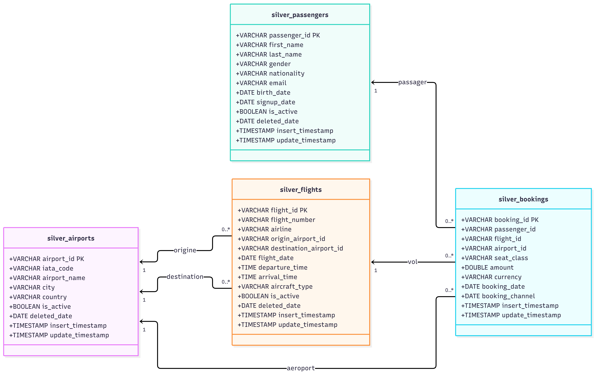
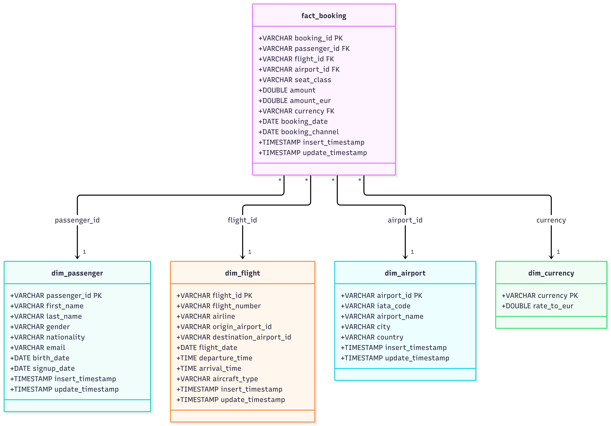

# Choix de modélisation

## Bronze

1. common.py :
    - fetch_csv :
        - créer le dossier bronze s'il n'existe pas
        - créer le dossier du mois s'il n'existe pas
        - télécharge le fichier s'il n'existe pas déjà
        - retourne le dataframe pandas

2. Airports : ingest_bronze
    - ingest_bronze : télécharge le fichier csv dans le dossier init ou du mois correspondant

3. Flights : Idem Airports

4. Passengers : _snapshot_file_(en|fr) & ingest_bronze
    - snapshot_file(en|fr) : renvoie le dossier associé au fichier (en|fr)
    - ingest_bronze :  télécharge séparément les fichiers (en|fr)

5. Bookings : Idem Airports

## Silver

1. Airports : ingest_silver :
    - Ajout des nouvelles airports
    - Mise à jour des informations en désactivant un ancien airport et en ajoutant le nouveau

2. Flights : ingest_silver :
    - Idem Airports

3. Passengers : ingest_silver :
    - Regroupe les données anglaises et françaises (fr --> en)
    - Idem Airports

4. Bookings : ingest_silver :
    - Sauvegarde des bookings sans les colonnes is_active & deleted_date (table de faits)
    - Idem Airports

## Gold

*À chaque ingestion les tables de dimensions et de faits sont réinitialisées. Puis les faits sont réinjectés avec les valeurs mises à jour (amélioration possible en conservant la table de faits).*

*Chaque clé primaire/étrangère n'est pas ajouté pour contrer les problèmes d'unicité dû à la désactivation des valeurs et non leur suppression.*

1. Airports : ingest_gold :
    - Copie de la table silver (pas besoin de vérifier la colonne is_active puisque aucun airport n'est supprimé)

2. Flights : ingest_gold :
    - Idem Airports

3. Passengers : ingest_gold :
    - Idem Airports

4. Bookings : ingest_gold :
    - Idem Airports

